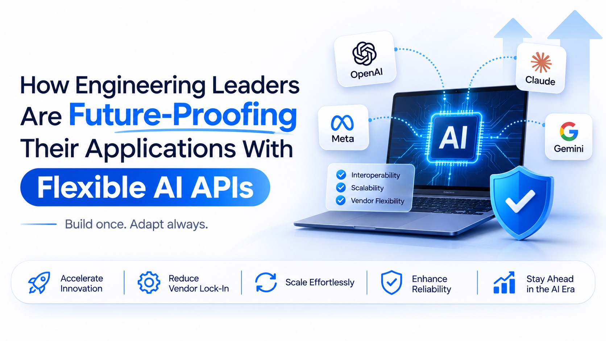

# How Engineering Leaders Are Future-Proofing Their Applications With Flexible AI APIs



The model that is best for your product today may not be best next quarter. Prices drop, new models launch, limits change, and providers have outages. Teams that wired one vendor deep into their code feel each of those changes as a rewrite. Teams that put a flexible API layer in between feel them as a configuration change.

The approach most engineering leaders reach is a single internal gateway, the idea behind [multi-model LLM API orchestration](https://zignuts.com/ai-services/ai-integration/ai-api-integration-services?utm_source=seo_web2.0&utm_medium=backlink&utm_campaign=seo_referral&utm_id=11), where requests are routed to the right model through one stable interface.

## Gateway Architecture

```
Application services
        |
   AI Gateway   (one contract, auth, policy, logging, cost)
     /    |    \
Model A  Model B  Model C   (hosted, open, or self-run)
```

## The Cost of Tight Coupling

| Problem | What it looks like |
|---|---|
| Lock-in | Switching is expensive, so pricing power moves to the vendor |
| Fragility | One provider outage becomes your outage |
| Slow adoption | A better model sits unused because trying it needs engineering work |
| Scattered controls | Keys, logging, and redaction differ in each service |

## One Contract, Many Models

Applications ask for a capability, not for a vendor.

```json
POST /v1/generate
{
  "task":       "summarize",
  "tier":       "balanced",
  "input":      "...",
  "max_cost":   0.02,
  "data_class": "internal"
}
```

The gateway chooses the model for that task, tier, cost ceiling, and data class.

## Routing Strategies

| Strategy | How it works | Benefit |
|---|---|---|
| Task-based routing | Simple tasks go to small models, hard ones to stronger models | Lower cost per task |
| Fallback chain | Retry on another provider after a timeout or rate limit | Higher availability |
| Data-class rules | Sensitive requests stay on approved or self-hosted models | Compliance control |
| Canary and shadow | A small share or silent copy of traffic goes to a new model | Safe evaluation |
| Budget limits | Cap spend per team, feature, or tenant | Predictable cost |

## Governance Checklist

- [ ] Provider keys live in the gateway, never in application code
- [ ] Prompts and outputs are logged with redaction of sensitive fields
- [ ] Per-team access and rate limits are enforced centrally
- [ ] Requests carry user and tenant identity for audit
- [ ] Provider data handling terms are reviewed and recorded

## Migration Path

1. **Inventory** every place the code calls an AI provider.
2. **Introduce the contract** with one internal request and response shape.
3. **Wrap one provider** and route existing traffic through the gateway with no behavior change.
4. **Move services over** feature by feature, using the same test set before and after.
5. **Add a second model** to prove the swap, then enable routing and fallback.

## Get Started

Ready to make your AI layer flexible? Visit [zignuts.com](https://zignuts.com/) to speak with the team.
